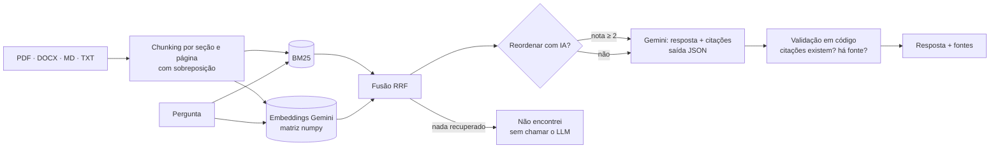
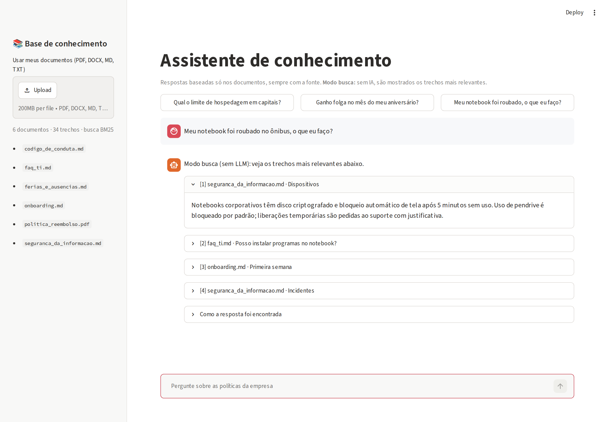

# 📚 AI Knowledge Assistant: RAG sobre documentos internos, com fontes verificadas

**Um assistente que responde dúvidas de colaboradores a partir das políticas da empresa (reembolso, férias, segurança, onboarding, conduta, TI), sempre mostrando de qual documento, seção e página veio a resposta, e que diz "não encontrei" quando a informação não está lá.**

É a evolução do meu [chatbot-pdf](https://github.com/henriquecm02/chatbot-pdf), que criava o índice vetorial mas nunca o usava na resposta. Aqui a recuperação é medida antes de qualquer geração.

## O problema

As políticas internas ficam espalhadas em PDFs e páginas que ninguém lê inteiras. As mesmas perguntas ("qual o limite de hospedagem?", "quando peço férias?") chegam ao RH, ao financeiro e ao suporte toda semana. Um chatbot genérico **inventa respostas plausíveis**, o que é pior do que não responder.

**Usuário-alvo:** colaboradores (quem pergunta) e as áreas que mantêm as políticas (quem para de responder sempre a mesma coisa).

## Como funciona



| Etapa | Decisão | Por quê |
|---|---|---|
| Chunking | por seção (títulos Markdown ou numeração em PDF) e página, corte só quando a seção passa de 900 caracteres | cada trecho vira uma citação legível: `politica_reembolso.pdf · 2. Limites · p. 1` |
| Busca léxica | BM25 próprio, com remoção de acentos, stopwords e *stemming* leve para português | acerta valores, siglas e termos exatos; funciona sem modelo |
| Busca semântica | embeddings do Gemini (`RETRIEVAL_DOCUMENT` e `RETRIEVAL_QUERY`) em matriz numpy | acerta paráfrases. Até dezenas de milhares de trechos, a busca exata é rápida e dispensa banco vetorial |
| Fusão | Reciprocal Rank Fusion | combina rankings sem calibrar escalas de score diferentes |
| Reordenação | opcional: o LLM dá nota de 0 a 3 a cada trecho e os abaixo de 2 são descartados | aumenta a precisão quando há muitos trechos parecidos |
| Geração | JSON com `resposta`, `encontrou`, `citacoes` | estrutura verificável |
| Garantias em código | citações a trechos inexistentes são removidas; "encontrei" sem citação vira "não verificado"; sem trecho recuperado, o LLM não é chamado | o modelo não decide sozinho se a resposta é confiável |

## Avaliação

[`eval/perguntas.json`](eval/perguntas.json) traz 38 perguntas com o trecho correto marcado:

- **20 diretas**, que usam as palavras do documento;
- **14 paráfrases**, como "posso pegar Uber voltando tarde?" para a regra de táxi entre 22h e 6h;
- **4 sem resposta** na base, em que o correto é se abster.

### Recuperação (medida, sem LLM)

`python eval/run_eval.py` ([resultado](eval/resultados/)):

| Modo | Perguntas | Recall@1 | Recall@3 | Recall@5 | MRR |
|---|---|---|---|---|---|
| BM25 | diretas (20) | 1,00 | 1,00 | 1,00 | 1,00 |
| BM25 | **paráfrases (14)** | **0,64** | 0,79 | 0,86 | 0,73 |
| Denso (Gemini) | — | ⏳ | ⏳ | ⏳ | ⏳ |
| Híbrido (RRF) | — | ⏳ | ⏳ | ⏳ | ⏳ |

**Leitura honesta:** as perguntas diretas são fáceis por construção, porque eu escrevi a base e as perguntas. O número informativo é o das paráfrases: o BM25 erra o primeiro trecho em 5 de 14 e não encontra nada para "ajuda de custo para trabalhar de casa" (o documento diz "auxílio home office"). É exatamente a lacuna que a busca semântica deve fechar. Não ajustei o BM25 olhando essas perguntas, para não inflar o resultado.



> Captura do modo busca (sem IA) para a paráfrase "meu notebook foi roubado no ônibus": o trecho correto ("Incidentes": comunicar em até 1 hora) aparece só em 4º. Esse é o caso que embeddings e reordenação devem resolver.

### Respostas (pendente)

`python eval/run_eval.py --llm` mede, para o modo híbrido com e sem reordenação:

- se a resposta contém o fato esperado (valor ou prazo);
- se cita o trecho correto;
- se se abstém nas 4 perguntas sem resposta.

## Status da validação

| Componente | Status |
|---|---|
| Leitura de PDF, DOCX e MD, chunking com página e seção | ✅ testado |
| BM25 e avaliação de recuperação | ✅ medido (tabela acima) |
| Garantias de citação e abstenção | ✅ testado com LLM roteirizado (11 testes) |
| Modo busca na interface (sem chave) | ✅ executado |
| Embeddings, busca híbrida, reordenação e respostas do Gemini | ⏳ **pendente**: código e avaliação prontos, falta rodar com a chave |

## Como rodar

```bash
python -m venv .venv && source .venv/bin/activate
pip install -e ".[ui,dev]"
pytest -q
python eval/run_eval.py                 # avaliação da recuperação (sem chave)
streamlit run app/streamlit_app.py      # modo busca sem chave; com GEMINI_API_KEY, respostas geradas
```

Para usar com os seus documentos, envie os arquivos pela barra lateral da interface ou coloque-os em `corpus/`.

## Limitações

- PDFs escaneados (imagem) não têm texto extraível; precisaria de OCR antes.
- Tabelas complexas em PDF perdem a estrutura na extração de texto.
- O índice é reconstruído a cada inicialização (rápido para dezenas de documentos; para milhares, persistir os vetores).
- Base de demonstração pequena (6 documentos, 34 trechos), de uma empresa fictícia.

## Roadmap

- [ ] Rodar a avaliação completa com o Gemini e publicar denso × híbrido × reordenação
- [ ] Comparação entre documentos ("o que mudou da versão 3.1 para a 3.2?")
- [ ] Persistir índice e embeddings (SQLite) para bases maiores
- [ ] Feedback 👍/👎 na interface para alimentar o conjunto de avaliação

---

Todos os documentos de `corpus/` são de uma empresa **fictícia**. Licença MIT.
